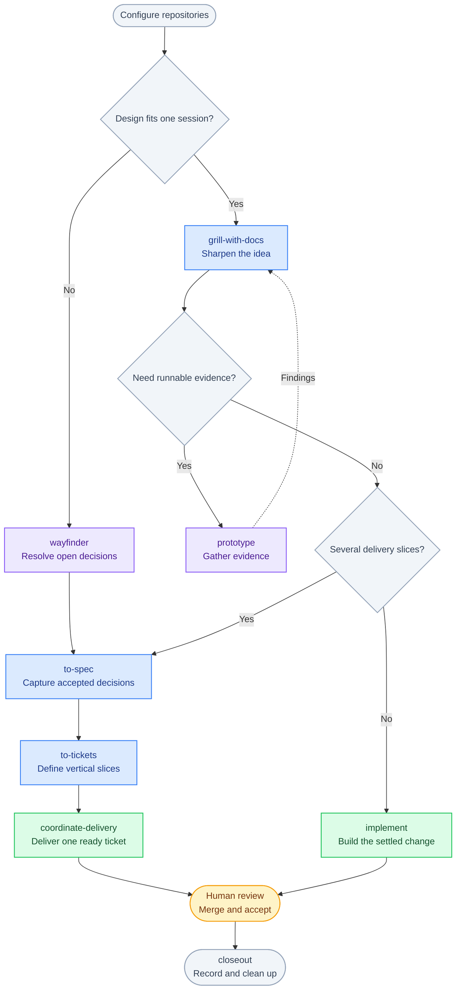

# Agent Smitty

[](https://github.com/siarhei-belavus/agent-smitty/actions/workflows/validate.yml)
[](LICENSE)

Agent skills for taking an idea through design, specification, implementation, review, and delivery across one or several repositories.

This is my evolution of [Matt Pocock's skills](https://github.com/mattpocock/skills). It keeps the emphasis on asking hard questions, deep modules, and tests through public interfaces, and extends the workflow with repository-owned provider configuration, shared domain modeling, and coordinated delivery across repositories.

## Install

With Node.js and npm available, run this in your project:

```sh
npx skills add siarhei-belavus/agent-smitty
```

Choose the skills and agents in the installer. To install the complete workflow for Codex:

```sh
npx skills add siarhei-belavus/agent-smitty --skill '*' --agent codex
```

Add `--global` to install across projects. To browse the catalog first:

```sh
npx skills add siarhei-belavus/agent-smitty --list
```

You can install an individual skill with `--skill diagnosing-bugs`. Its linked reference files travel with it. Skills that compose other skills, such as `implement` using `tdd`, also need those skills installed. Install the full pack for the complete workflow.

[Installation and requirements](docs/installation.md) · [Workflow guide](docs/workflow.md) · [Skill catalog](docs/skills.md)

## Start with the work you have

| Your situation | Start here |
| --- | --- |
| Set up a repository or a group of repositories | `setup-federated-workflow` |
| Sharpen an idea against an existing codebase | `grill-with-docs` |
| Explore a plan without a codebase | `grill-me` |
| Resolve a large effort with unanswered decisions | `wayfinder` |
| Turn accepted decisions into a specification | `to-spec` |
| Split a specification into executable slices | `to-tickets` |
| Deliver one ready ticket across its repositories | `coordinate-delivery` |
| Implement a small, settled task directly | `implement` |
| Investigate a failure | `diagnosing-bugs` |
| Choose a route through the skills | `ask-smitt` |

Ask your agent to use a skill by name. Invocation syntax depends on the agent. For example:

```text
Use grill-with-docs to work through adding team invitations.
```

## The main workflow



Keep idea refinement, specification, and ticket preparation in one conversation. A ready ticket carries the decisions another conversation needs to execute it. Use `handoff` when ownership or repository context changes.

For a delivery spanning several repositories, the coordinator prepares an isolated worktree per writable repository, delegates implementation, reviews each result, publishes draft PRs or MRs, and validates the combined result. It hands the ticket back as `ready-for-human`. The human owns merging and acceptance.

[Read the workflow guide](docs/workflow.md) for setup, specification preparation, multi-repository planning, recovery, and closeout.

## What's in the pack

- [Engineering](skills/engineering/README.md): planning, domain modeling, implementation, testing, review, and delivery.
- [Productivity](skills/productivity/README.md): interviews, handoffs, learning, and writing for agents.
- [Shared workflow contracts](skills/engineering/federated-workflow/): the records and rules used by planning and delivery skills.

The public catalog contains stable skills. Experimental writing tools, one-off migrations, and personal collection-maintenance tools are outside this pack.

## Contribute

See [CONTRIBUTING.md](CONTRIBUTING.md) for the repository layout, reference packaging, and validation commands. Report a problem with the skill name, the situation that triggered it, and the behavior you expected. Remove credentials and private project data from examples.

## Credits and license

Derived from [Matt Pocock's skills](https://github.com/mattpocock/skills), under the MIT license. Agent Smitty develops that foundation for my own engineering workflow. This is an independent project.

See [credits](docs/credits.md) for attribution and [LICENSE](LICENSE) for reuse terms.
