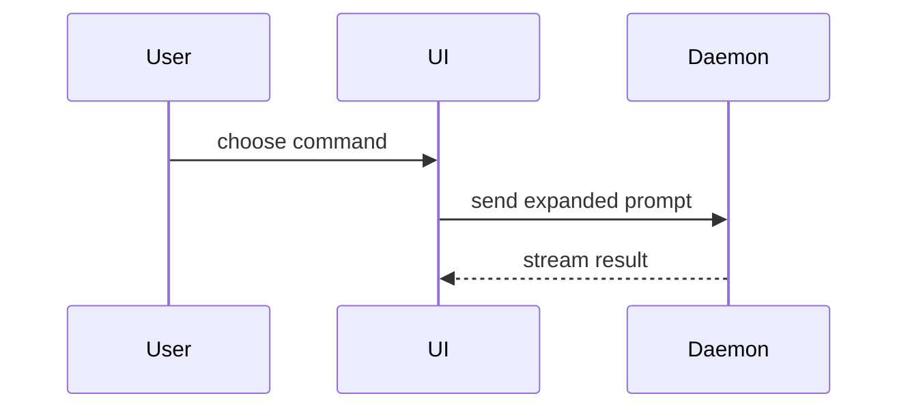

Write the description of one pull request or merge request, called a Review Proposal in the delivery workflow. This skill owns description content only. The caller retains authority over publication, draft state, review, merge, and ticket transitions.

Use the target repository's instructions, proposal template, and `docs/agents/code-host.md` binding when present. Their required content and rendering format take precedence over the default template below. Render diagrams and code in the provider-supported format.

For a multi-repository delivery, describe this proposal's repository-specific change and evidence. Link related proposals and explain cross-repository dependencies or required rollout order. Distinguish repository validation from bundle validation; claim a bundle result only when supplied evidence covers the exact participating revisions.

Use the applicable canonical domain vocabulary. Follow configured Domain Orientation through `docs/agents/domain.md` when present. Otherwise read the relevant `CONTEXT.md` through `CONTEXT-MAP.md`, or the root `CONTEXT.md`. Use the repository's language when no domain document exists.

Use this default template when the repository supplies none:

```markdown
## Summary

<brief description of the problem and resulting behavior; a visual when useful>

## Evidence

- **Before:** <screenshot/output/failing test run>
  **After:** <screenshot/output/passing test run>

## Merge risk

**Door:** <one-way or two-way>

<optional: description>

**Affected scope:** <consumers, data, or workflows affected>

<optional: potential ramifications of merge>
```

## Sections

Keep prose brief and detail proportional to the change.

### Summary

Lead with the problem and resulting behavior. Use a visual when it makes the change easier to assess. Choose the smallest view that explains it.

- Show logic or an algorithm as pseudocode:

```text
on(save)
  if content is unchanged
    return cached result
  write new content
  return fresh result
```

- Show runtime control flow as a call tree:

```text
submitForm
  createSession
    persistPrompt
    launchAgent
  navigateToSession
```

- Show UI structure as a component tree, including state and module boundaries that matter:

```text
<SessionPage> (apps/example/src/routes/session.tsx)
  useSessionEvents()
  <SessionToolbar>
    <RunSkillButton> (packages/ui)
```

- Show file responsibility or a broad refactor as a shallow file tree:

```text
src/
├── commands/       # parses user actions
├── sessions/       # owns session state
└── transport/      # sends API requests
```

- Show component interaction, control flow, or data flow with Mermaid:



- Use `diff` when the point is what changes and the surrounding shape already exists. Match the diff shape to the topic.

For a component change:

```diff
 <SessionPage>
   useSessionEvents()
   <SessionToolbar>
+    <RunSkillButton />
   <SessionTimeline>
+    <SkillResultCard />
```

For a file-layout change:

```diff
 src/
 ├── commands/
+│   └── show-me.ts       # expands the slash command
 ├── sessions/
-└── transport.ts
+└── transport/
+    ├── client.ts
+    └── stream.ts
```

For a call-tree or call-stack change:

```diff
 submitForm
   createSession
     persistPrompt
+    expandSkillMention
     launchAgent
-  navigateToSession
+  navigateToSession
+    subscribeToEvents
```

For a state or control-flow change:

```diff
 on(save)
-  write content
+  if content is unchanged
+    return cached result
+  write new content
+  invalidate cache
```

- Show the whole block when most of it is new, when omitted context would hide ownership or order, or when the user needs a copyable target shape:

```ts
function expandSkill(command: string): string {
  const skillName = command.slice(1);
  return `use the ${skillName} skill`;
}
```

#### Guidance

Place each visual next to the short text it supports. Keep only the calls, files, props, states, and boundaries needed to answer the user's current question or the options to resolve the current discussion point.

You may use one of these, you may use several, it is unlikely you will use all of them. Use your judgement and don't overwhelm the user.

### Evidence

Use supplied validation evidence bound to the described revision. Show before and after when both were actually observed. For visual changes, use screenshots when available. For execution evidence, name the actual command, result, and relevant limitation. State missing evidence explicitly instead of inventing a failing run or presenting pseudocode as execution output.

### Merge risk

Describe whether it's a one-way or two-way door. You can walk back through two-way doors, but not one-way doors. A PR that is cheap to roll back is lower risk. Changes that involve destructive actions or hard-to-reverse decisions are one-way doors.

The blast radius is the potential impact or scope of the changes introduced by this PR. Consider all possibilities. Examples are layout shift, breakages for consumers, mobile responsiveness, etc.
